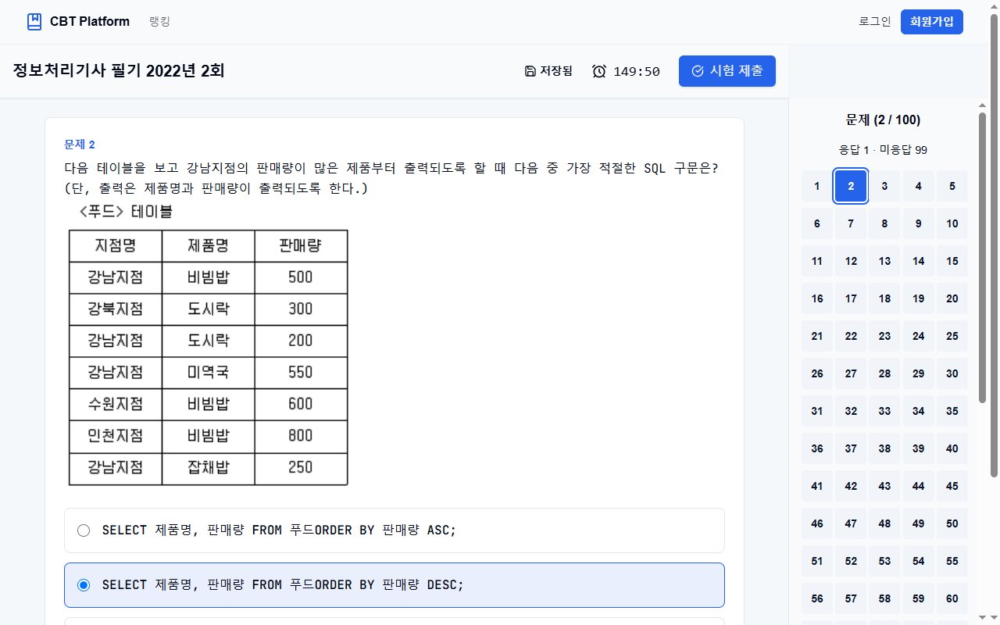
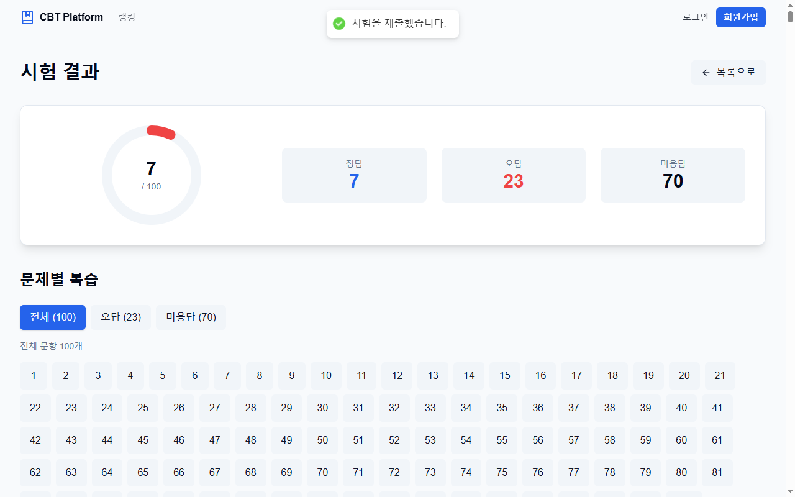
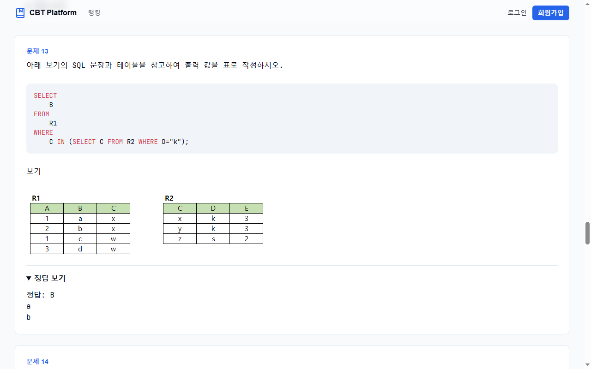
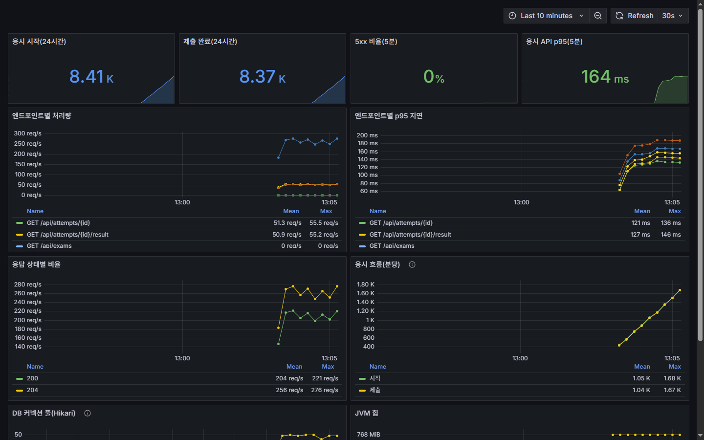
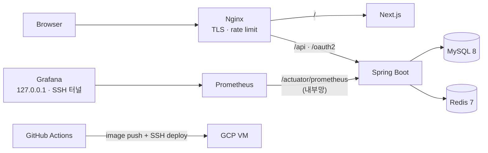

# CBT Exam Platform

자격증 기출문제를 실제 시험처럼 풀어 보는 CBT(Computer Based Test) 웹 서비스입니다.
게스트·회원 응시, 자동 저장, 서버 채점, 결과 리뷰, 실기 학습 모드, 종목별 랭킹을 제공합니다.

**서비스**: https://cert-cbt.site — 회원가입 없이 바로 응시할 수 있습니다.

## 한눈에 보기

- **운영 중인 서비스**: GCP VM에서 Nginx(TLS)·Spring Boot·Next.js·MySQL·Redis를 Docker Compose로 운영하고, GitHub Actions가 테스트 → MySQL 포함 전체 스택 통합 검증 → 커밋 SHA 이미지 배포까지 자동으로 진행합니다.
- **성능 병목 개선**: k6 부하 테스트로 시험 잠금 조회 안의 `COUNT` 서브쿼리를 찾아, 응시 기록 20만 건이 쌓인 시험의 응시 시작 p95를 **7.04s → 10.1ms**로 줄였습니다. 제출 한 번의 DB 왕복은 JDBC 배치로 **101회 → 3회**입니다. ([성능 문서](docs/PERFORMANCE.md))
- **정합성**: 여러 탭의 동시 제출·자동 저장 충돌을 행 잠금과 고유 제약으로 직렬화하고, CI가 실제 MySQL 8에서 동시 제출 결과가 같은지 검증합니다.
- **데이터 파이프라인**: 기출 PDF와 블로그를 파싱해 정보처리기사 **1,220문항**(필기 800, 실기 420)을 적재했습니다. 필기는 PDF의 정답 표시와 마지막 쪽 정답표를 대조해 **800/800** 일치를 확인했습니다.
- **운영 관측**: Micrometer·Prometheus·Grafana로 엔드포인트별 지연, 5xx 비율, DB 커넥션 풀, 업무 지표를 보고 경보 규칙 4종을 평가합니다.

## 화면

| 필기 응시 | 결과·복습 |
| --- | --- |
|  |  |
| **실기 학습**(정답 접기, 코드 구문 강조, 이미지 표) | **운영 대시보드**(Grafana, 로컬 k6 부하 테스트 중) |
|  |  |

## 주요 기능

| 기능 | 설명 |
| --- | --- |
| 시험 응시 | 제한시간 타이머, 답안 자동 저장, 새로고침 후 답안·남은 시간 복원, 시간 종료 시 자동 제출 |
| 게스트 응시 | 회원가입 없이 응시하고, 응시별 비밀키로 본인 응시만 조회 |
| 채점·리뷰 | 객관식·주관식 서버 채점, 문항별 정답·해설 리뷰, 응시 이력에서 이어서 풀기 |
| 실기 학습 | 실기 복원 문제를 정답 접기 방식으로 학습, 코드 블록 구문 강조(C·Java·Python·SQL), 문제 이미지 |
| 랭킹 | 자격증 종목별 필기 풀이 횟수 순위(비회원 포함) |
| 인증 | 아이디 로그인과 소셜 로그인(OAuth2), JWT + Refresh Token 회전 |
| 관리자 | 시리즈·시험·문항 편집, 공개 전환, 무작위 출제 |

정보처리기사 필기 기출과 실기 복원 문제를 수집·파싱해 적재했습니다(`scripts/`).

## 기술 스택

| 영역 | 기술 |
| --- | --- |
| Frontend | Next.js 16, React 19, TypeScript, Zustand, Tailwind CSS 4, Vitest |
| Backend | Java 17, Spring Boot 3.5, Spring Security, OAuth2 Client, JPA, Flyway, springdoc-openapi |
| Data | MySQL 8 (시험·응시·답안·랭킹의 기준 데이터), Redis 7 (로그인 세션, Refresh Token, 일회용 OAuth 코드) |
| Infra | Docker Compose, Nginx (리버스 프록시·TLS·요청 제한), GCP Compute Engine, Let's Encrypt |
| Observability | Micrometer, Prometheus (경보 규칙), Grafana (파일 프로비저닝 대시보드) |
| CI/CD | GitHub Actions: 테스트 → 통합 검증 → 커밋 SHA 이미지 빌드 → VM 배포 |

## 아키텍처



프론트엔드와 API가 같은 출처를 쓰므로 CORS·쿠키 문제 없이 Nginx 하나로 라우팅합니다. 인증과 응시 시작 경로는 IP별 요청 제한을 따로 겁니다.

**도메인 모델**: `ExamSeries → Exam → Question`으로 시험을, `User → Attempt → Answer`로 응시를 관리합니다. 게스트는 사용자 대신 응시별 비밀키로 소유권을 증명합니다.

## 핵심 설계와 문제 해결

### 동시 제출과 답안 정합성
- **문제**: 여러 탭에서 동시에 제출하거나, 자동 저장과 제출이 겹치면 답안이 이중 저장되거나 채점이 어긋날 수 있습니다.
- **해결**: 응시 행 잠금과 `answers(attempt_id, question_id)` 고유 제약으로 저장·제출을 직렬화하고, 최종 답안 저장과 채점을 한 트랜잭션에 넣었습니다. 재제출은 같은 결과를 반환합니다.

### 응시 중 문항 변경 방지
- **문제**: 관리자가 응시 도중 문항을 바꾸면 채점 기준이 흔들립니다.
- **해결**: 시험 행 잠금으로 응시 생성과 문항 교체를 조정하고, 응시가 하나라도 시작되면 문항 교체를 막습니다. 제한시간은 응시 시작 시점 값으로 보관합니다.

### 서버 기준 제한시간
- **문제**: 클라이언트 타이머는 조작할 수 있습니다.
- **해결**: 서버가 마감 시각을 검증해 마감 이후 답안 변경을 거절하고, 늦은 제출은 마감 전에 저장된 답안만 채점합니다.

### Refresh Token 회전 경쟁
- **문제**: 여러 탭이 동시에 토큰을 갱신하면 탈취된 토큰과 정상 요청을 구분하기 어렵습니다.
- **해결**: Redis Lua 비교·교체로 토큰을 원자적으로 회전합니다. 사용자당 활성 세션은 하나이며, 새 로그인·로그아웃 시 이전 토큰을 폐기합니다. 프론트엔드는 동시 401을 한 번의 갱신으로 모읍니다.

### OAuth 토큰 노출 방지
- **문제**: 리다이렉트 URL에 토큰을 실으면 브라우저 기록·로그에 남습니다.
- **해결**: 60초짜리 일회용 코드만 전달하고, 프론트엔드가 코드를 토큰으로 교환합니다. 비밀번호·토큰·답안 원문은 로그에 남기지 않습니다.

### 랭킹 집계
- **해결**: 랭킹은 Redis 캐시 대신 DB에 확정된 제출 기록에서 집계합니다. 공개된 필기 시험의 제출 완료 응시를 종목별로 세므로 Redis 장애나 중복 제출로 이중 집계되지 않습니다.

### 응시가 쌓일수록 느려지던 응시 시작
- **문제**: k6 부하 테스트에서 시험 조회마다 `@Formula` `COUNT(attempts)` 서브쿼리가 도는 것을 찾았습니다. 응시 시작은 시험을 `SELECT … FOR UPDATE`로 잠가 읽어서, 잠금을 쥔 채 응시 전체를 세는 동안 같은 시험의 응시 시작이 줄줄이 대기했습니다. 응시 20만 건이 쌓인 시험에서 응시 시작 p95가 7.04s까지 늘었습니다.
- **해결**: 화면에 쓰이지 않던 `attemptCount`를 엔티티에서 빼고 인기 시험 목록에서만 집계합니다. 같은 조건에서 p95가 **10.1ms**로, 응시가 적을 때(9.4ms)와 같아졌습니다.
- 채점 UPDATE는 JDBC 배치로 묶어 제출 한 번의 DB 왕복을 101회에서 3회로 줄였습니다. 측정 방법과 전체 수치는 [성능 측정 문서](docs/PERFORMANCE.md)에 있습니다.

### 스키마 관리
- Flyway로 스키마 변경 이력을 관리하고, 운영 Hibernate는 `ddl-auto: validate`로 검증만 합니다. 기존 데이터에 중복이 있으면 마이그레이션이 데이터를 임의로 지우지 않고 실패합니다.

## 기술 선택과 트레이드오프

| 선택 | 대안 | 고른 이유 | 감수한 것 |
| --- | --- | --- | --- |
| 응시 행 **비관적 락**(`SELECT … FOR UPDATE`) | 낙관적 락(`@Version`) + 재시도 | 같은 응시에서 자동 저장과 제출이 자주 겹칩니다. 충돌 때마다 재시도하기보다 짧게 기다리는 편이 단순하고, 잠금 범위가 응시 한 행이라 다른 사용자와는 경합하지 않습니다. | 잠금 안에서 느린 쿼리가 돌면 대기가 줄줄이 늘어납니다. 실제로 이 문제를 부하 테스트에서 찾아 고쳤습니다(위 "응시가 쌓일수록 느려지던 응시 시작"). |
| Refresh Token을 **Redis Lua**로 원자적 교체 | DB 토큰 테이블 + 행 잠금 | 비교·교체를 한 번에 처리하고 TTL로 저절로 만료됩니다. 인증 트래픽이 시험 데이터 DB에 부담을 주지 않습니다. | Redis 장애 시 로그인·갱신이 실패합니다. 게스트 응시·채점·랭킹은 MySQL만 쓰므로 영향이 없습니다. |
| 랭킹을 **DB 제출 기록에서 집계** | Redis Sorted Set 캐시 | 커밋된 제출만 세므로 중복 제출이나 캐시와 DB의 이중 쓰기로 숫자가 어긋날 일이 없습니다. | 기록이 매우 많아지면 조회마다 집계 비용이 듭니다. 그때는 카운터 컬럼이나 캐시로 바꿀 계획입니다. |
| **같은 출처**(Nginx 하나로 프론트·API 라우팅) | API 별도 도메인 | CORS·쿠키 설정이 필요 없고, 요청 제한과 TLS를 한 곳에서 관리합니다. | 프론트와 API를 따로 확장하려면 라우팅을 다시 나눠야 합니다. |
| **단일 VM + Docker Compose** | Kubernetes, 관리형 서비스 | 비용과 운영 부담이 작고, 커밋 SHA 태그 이미지로 배포·롤백이 단순합니다. | 단일 장애점이고 수평 확장이 없습니다. 디스크 스냅샷과 이미지 롤백으로 복구합니다. |
| 실기는 **채점 대신 학습 모드** | 주관식 완전일치 채점 | 복원 답안은 서술형·소문항이 많아 문자열 비교로는 공정하게 채점할 수 없습니다. 정답·해설을 접어 두고 스스로 확인하게 했습니다. | 실기는 점수와 랭킹에 반영되지 않습니다. |
| 모니터링을 **별도 Compose 파일**로 | 기본 스택에 포함 | CI와 로컬 실행에는 부담을 주지 않고, 운영에서만 켭니다. 필수 비밀번호 검사가 꺼진 구성에까지 걸리지 않습니다. | 켜는 절차가 하나 늘어납니다(운영 문서에 정리). |

## 트러블슈팅

### 배포가 조용히 막혀 있던 문제
- **현상**: 랭킹 API를 개편해 푸시했는데 운영 화면이 바뀌지 않았습니다. 이후 커밋도 운영에 반영되지 않았습니다.
- **원인**: CI의 스모크 테스트가 제거된 옛 랭킹 API를 계속 호출해 404로 실패했고, 통합 검증 실패로 배포 단계가 건너뛰어졌습니다. 푸시 후 파이프라인 결과를 확인하지 않아 두 커밋 동안 몰랐습니다.
- **해결**: 스모크 테스트를 새 API로 바꾸면서 동시·중복 제출이 한 번씩만 집계되는지까지 검증하게 했습니다. 스모크 테스트가 API 계약을 지키는 마지막 안전장치라는 점, 푸시 후 파이프라인 결과까지 확인해야 배포가 끝난다는 점을 배웠습니다.

### `.env`를 바꾸자 백엔드가 DB에 접속하지 못한 문제
- **현상**: 로컬 `.env`의 DB 비밀번호를 바꾼 뒤 백엔드가 `Access denied for user 'cbt_user'`로 재시작을 반복했습니다.
- **원인**: MySQL 공식 이미지는 **볼륨이 비어 있을 때만** `MYSQL_PASSWORD`로 계정을 만듭니다. 이미 초기화된 볼륨에는 예전 비밀번호가 남아 있어 새 `.env`와 맞지 않았습니다.
- **해결**: 개발 환경이라 볼륨을 다시 만들었습니다. 운영 DB는 데이터를 지울 수 없으므로 `ALTER USER`로 계정 비밀번호를 먼저 바꾼 뒤 `.env`를 교체해야 합니다([운영 문서](docs/OPERATIONS.md)의 비밀값 교체 항목 참고).

### Windows에서만 프론트엔드 빌드가 실패한 문제
- **현상**: `npm run build`가 `/_global-error` 사전 렌더링 중 `Cannot read properties of null (reading 'useContext')`로 실패했습니다. 같은 커밋이 CI(Linux)에서는 통과했습니다.
- **원인**: 실제 폴더 이름은 `CBT`인데 셸에서 `cbt`로 들어가 빌드했습니다. Windows 파일 시스템은 대소문자를 구분하지 않지만 Node 모듈 캐시는 경로 문자열로 모듈을 구분해서, React가 두 벌 로드되었습니다.
- **해결**: 실제 대소문자 경로에서 빌드합니다. 대소문자를 구분하는 Linux CI에서는 생기지 않는 문제입니다.

### 기출 PDF에서 보기 이미지가 엉뚱한 보기에 붙던 문제
- **현상**: 보기가 그림인 필기 문항 11개에서 이미지가 다른 보기에 붙거나 문제 본문으로 들어갔습니다.
- **원인**: 2단 편집 PDF에서 보기 표시(①②)와 이미지가 같은 줄 또는 아랫줄에 놓이는데, 이미지 상단이 글자보다 조금 높아 읽기 순서상 표시보다 먼저 나왔습니다.
- **해결**: 문항이 끝날 때 이미지와 보기 표시의 좌표를 모아, 같은 줄 왼쪽에 가장 가까운 표시 → 바로 위 줄 표시 순으로 배치했습니다. 정답은 채움 번호(❶~❹)와 정답표 두 곳을 대조해 800문항 모두 일치를 확인했습니다([`scripts/parse_comcbt.py`](scripts/parse_comcbt.py)).

## 테스트와 CI/CD

- **백엔드**: H2 기반 테스트로 역할 상승 차단, 비공개 시험 접근 차단, 게스트 소유권, 채점 규칙, 종목 랭킹 집계, 인기 시험 정렬, 지표 노출을 검증합니다. 잠금 동작은 MySQL과 H2가 다르므로 동시 제출은 아래 통합 검증에서 실제 MySQL로 확인합니다.
- **프론트엔드**: Vitest로 API 오류 처리, 동시 토큰 갱신, 게스트 키, 답안 복원, 타이머를 검증합니다.
- **통합 검증**: CI가 임시 비밀값으로 MySQL·Redis를 포함한 전체 스택을 띄우고 `scripts/smoke_test.py`로 동시 제출·토큰 회전 경쟁·로그아웃 등을 확인한 뒤 정리합니다.
- **배포**: 모든 검사를 통과하면 커밋 SHA 태그로 이미지를 빌드해 GCP VM에 배포합니다. 롤백은 이전 SHA를 `IMAGE_TAG`로 지정합니다.
- **관측**: 백엔드가 엔드포인트별 지연 히스토그램, Hikari 풀, JVM, 업무 지표(커밋된 응시 시작·제출 수)를 내보내고, Prometheus가 수집해 5xx 비율·응시 API p95·DB 커넥션 대기 경보를 평가합니다. Grafana 대시보드는 코드로 관리하며 SSH 터널로만 접속합니다([운영 문서](docs/OPERATIONS.md#운영-관측prometheus--grafana)).
- **부하 테스트**: [`loadtest/`](loadtest/)의 k6 시나리오로 응시 흐름 전체와 응시 시작을 따로 잽니다([성능 문서](docs/PERFORMANCE.md)).

## 데이터 출처

학습과 포트폴리오 목적으로 공개 자료를 가공했습니다. 원본 PDF와 추출한 문항·이미지 데이터는 저장소에 포함하지 않고(위 화면 캡처에 보이는 일부 제외), 수집·파싱 스크립트만 공개합니다.

- **필기**: 전자문제집 CBT(comcbt.com)의 정보처리기사 필기 기출 교사용 자료, 2020년 1·2회 ~ 2022년 2회 8회차 ([`scripts/parse_comcbt.py`](scripts/parse_comcbt.py)).
- **실기**: chobopark.tistory.com(Life-Journey)의 복원 문제, CC BY 4.0. 수험생 기억으로 복원한 문제라 실제 시험과 다를 수 있습니다 ([`scripts/scrape_chobopark.py`](scripts/scrape_chobopark.py)).

## 실행 방법

Docker Desktop 또는 Docker Engine + Compose가 필요합니다.

1. `.env.example`을 `.env`로 복사합니다.
2. DB 비밀번호 2개와 JWT 키를 서로 다른 임의 값으로 바꿉니다. JWT 키는 32바이트 이상이어야 합니다.
3. `docker compose up -d --build --wait`를 실행합니다.
4. `http://localhost`를 엽니다.

빈 DB는 Flyway가 생성합니다. 기존 DB는 [운영 문서](docs/OPERATIONS.md)의 마이그레이션 절차를 먼저 확인하세요.

<details>
<summary>개발 서버와 검증 명령</summary>

**프론트엔드**: `cd cbt-fe && npm ci && npm run dev`. API는 같은 출처의 `/api`를 쓰고 개발 서버가 `localhost:8080`으로 전달합니다. 전달 대상은 `INTERNAL_API_URL`로 바꿀 수 있습니다.

**백엔드**: Java 17, MySQL, Redis를 준비하고 `JWT_SECRET`, `SPRING_DATASOURCE_PASSWORD`, DB/Redis 연결 환경변수를 설정한 뒤 `cbt-be`에서 `./gradlew bootRun`(Windows는 `gradlew.bat`)을 실행합니다. Spring Boot는 루트 `.env`를 자동으로 읽지 않습니다.

```sh
cd cbt-be && ./gradlew test bootJar
cd ../cbt-fe && npm ci && npm run lint && npm run typecheck && npm test && npm run build && npm run audit
```

**통합 검증**: 운영 DB가 아닌 임시 환경 파일(`HTTP_PORT=18080`, `FRONTEND_URL=http://localhost:18080`)로 실행합니다.

```sh
docker compose --env-file /path/to/test.env -p cbt-validation-local up -d --build --wait
python scripts/smoke_test.py --env-file /path/to/test.env --project cbt-validation-local
docker compose --env-file /path/to/test.env -p cbt-validation-local down --volumes
```
</details>

<details>
<summary>동작 규칙</summary>

- 시험은 비공개로 생성하고, 유효한 문항을 저장한 뒤 공개합니다.
- 회원 응시는 소유자만, 게스트 응시는 시작한 브라우저의 비밀키로만 접근합니다.
- 주관식은 쉼표로 구분된 허용 답 중 하나와 일치하면 정답입니다. 앞뒤 공백을 지우고 대소문자는 무시합니다. 답 안의 쉼표는 `\,`로 씁니다.
- 실기 시험은 응시 대신 정답·해설을 공개하는 학습 모드로 제공합니다.
- 응시가 있는 시험은 일반 삭제가 거절됩니다. 관리자 시리즈 강제 삭제는 시험·응시·답안을 모두 지우므로 별도 확인이 필요합니다.
- OAuth는 설정된 공급자만 표시합니다.
</details>

## 한계

부하 테스트는 로컬 Docker Desktop 환경에서만 했고(약 410 req/s에서 포화, 병목은 요청마다의 `COMMIT` 디스크 동기화), 운영 환경의 처리량이나 SLA는 측정하지 않았습니다. OAuth 실계정과 실제 도메인의 TLS는 배포 환경에서 검증해야 합니다.

## 문서

- [운영·마이그레이션·HTTPS·OAuth](docs/OPERATIONS.md)
- [성능 측정과 개선(k6)](docs/PERFORMANCE.md)
