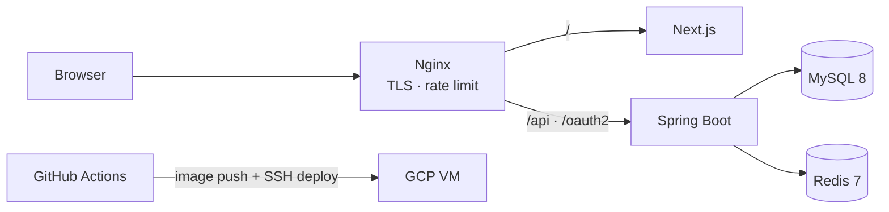

# CBT Exam Platform

자격증 기출문제를 실제 시험처럼 풀어 보는 CBT(Computer Based Test) 웹 서비스입니다.
게스트·회원 응시, 자동 저장, 서버 채점, 결과 리뷰, 실기 학습 모드, 종목별 랭킹을 제공합니다.

**서비스**: https://cert-cbt.site

## 주요 기능

| 기능 | 설명 |
| --- | --- |
| 시험 응시 | 제한시간 타이머, 답안 자동 저장, 새로고침 후 답안·남은 시간 복원, 시간 종료 시 자동 제출 |
| 게스트 응시 | 회원가입 없이 응시하고, 응시별 비밀키로 본인 응시만 조회 |
| 채점·리뷰 | 객관식·주관식 서버 채점, 문항별 정답·해설 리뷰, 응시 이력에서 이어서 풀기 |
| 실기 학습 | 실기 복원 문제를 정답 접기 방식으로 학습, 코드 블록 구문 강조(C·Java·Python·SQL), 문제 이미지 |
| 랭킹 | 자격증 종목별 필기 풀이 횟수 순위(비회원 포함) |
| 인증 | 아이디 로그인과 소셜 로그인(OAuth2), JWT + Refresh Token 회전 |
| 관리자 | 시리즈·시험·문항 편집, 공개 전환, 무작위 출제 |

정보처리기사 필기 기출과 실기 복원 문제를 수집·파싱해 적재했습니다(`scripts/`).

## 기술 스택

| 영역 | 기술 |
| --- | --- |
| Frontend | Next.js 16, React 19, TypeScript, Zustand, Tailwind CSS 4, Vitest |
| Backend | Java 17, Spring Boot 3.5, Spring Security, OAuth2 Client, JPA, Flyway, springdoc-openapi |
| Data | MySQL 8 (시험·응시·답안·랭킹의 기준 데이터), Redis 7 (로그인 세션, Refresh Token, 일회용 OAuth 코드) |
| Infra | Docker Compose, Nginx (리버스 프록시·TLS·요청 제한), GCP Compute Engine, Let's Encrypt |
| Observability | Micrometer, Prometheus (경보 규칙), Grafana (파일 프로비저닝 대시보드) |
| CI/CD | GitHub Actions: 테스트 → 통합 검증 → 커밋 SHA 이미지 빌드 → VM 배포 |

## 아키텍처



프론트엔드와 API가 같은 출처를 쓰므로 CORS·쿠키 문제 없이 Nginx 하나로 라우팅합니다. 인증과 응시 시작 경로는 IP별 요청 제한을 따로 겁니다.

**도메인 모델**: `ExamSeries → Exam → Question`으로 시험을, `User → Attempt → Answer`로 응시를 관리합니다. 게스트는 사용자 대신 응시별 비밀키로 소유권을 증명합니다.

## 핵심 설계와 문제 해결

### 동시 제출과 답안 정합성
- **문제**: 여러 탭에서 동시에 제출하거나, 자동 저장과 제출이 겹치면 답안이 이중 저장되거나 채점이 어긋날 수 있습니다.
- **해결**: 응시 행 잠금과 `answers(attempt_id, question_id)` 고유 제약으로 저장·제출을 직렬화하고, 최종 답안 저장과 채점을 한 트랜잭션에 넣었습니다. 재제출은 같은 결과를 반환합니다.

### 응시 중 문항 변경 방지
- **문제**: 관리자가 응시 도중 문항을 바꾸면 채점 기준이 흔들립니다.
- **해결**: 시험 행 잠금으로 응시 생성과 문항 교체를 조정하고, 응시가 하나라도 시작되면 문항 교체를 막습니다. 제한시간은 응시 시작 시점 값으로 보관합니다.

### 서버 기준 제한시간
- **문제**: 클라이언트 타이머는 조작할 수 있습니다.
- **해결**: 서버가 마감 시각을 검증해 마감 이후 답안 변경을 거절하고, 늦은 제출은 마감 전에 저장된 답안만 채점합니다.

### Refresh Token 회전 경쟁
- **문제**: 여러 탭이 동시에 토큰을 갱신하면 탈취된 토큰과 정상 요청을 구분하기 어렵습니다.
- **해결**: Redis Lua 비교·교체로 토큰을 원자적으로 회전합니다. 사용자당 활성 세션은 하나이며, 새 로그인·로그아웃 시 이전 토큰을 폐기합니다. 프론트엔드는 동시 401을 한 번의 갱신으로 모읍니다.

### OAuth 토큰 노출 방지
- **문제**: 리다이렉트 URL에 토큰을 실으면 브라우저 기록·로그에 남습니다.
- **해결**: 60초짜리 일회용 코드만 전달하고, 프론트엔드가 코드를 토큰으로 교환합니다. 비밀번호·토큰·답안 원문은 로그에 남기지 않습니다.

### 랭킹 집계
- **해결**: 랭킹은 Redis 캐시 대신 DB에 확정된 제출 기록에서 집계합니다. 공개된 필기 시험의 제출 완료 응시를 종목별로 세므로 Redis 장애나 중복 제출로 이중 집계되지 않습니다.

### 응시가 쌓일수록 느려지던 응시 시작
- **문제**: k6 부하 테스트에서 시험 조회마다 `@Formula` `COUNT(attempts)` 서브쿼리가 도는 것을 찾았습니다. 응시 시작은 시험을 `SELECT … FOR UPDATE`로 잠가 읽어서, 잠금을 쥔 채 응시 전체를 세는 동안 같은 시험의 응시 시작이 줄줄이 대기했습니다. 응시 20만 건이 쌓인 시험에서 응시 시작 p95가 7.04s까지 늘었습니다.
- **해결**: 화면에 쓰이지 않던 `attemptCount`를 엔티티에서 빼고 인기 시험 목록에서만 집계합니다. 같은 조건에서 p95가 **10.1ms**로, 응시가 적을 때(9.4ms)와 같아졌습니다.
- 채점 UPDATE는 JDBC 배치로 묶어 제출 한 번의 DB 왕복을 101회에서 3회로 줄였습니다. 측정 방법과 전체 수치는 [성능 측정 문서](docs/PERFORMANCE.md)에 있습니다.

### 스키마 관리
- Flyway로 스키마 변경 이력을 관리하고, 운영 Hibernate는 `ddl-auto: validate`로 검증만 합니다. 기존 데이터에 중복이 있으면 마이그레이션이 데이터를 임의로 지우지 않고 실패합니다.

## 테스트와 CI/CD

- **백엔드**: H2 기반 테스트로 역할 상승 차단, 비공개 시험 접근 차단, 게스트 소유권, 채점 규칙을 검증합니다.
- **프론트엔드**: Vitest로 API 오류 처리, 동시 토큰 갱신, 게스트 키, 답안 복원, 타이머를 검증합니다.
- **통합 검증**: CI가 임시 비밀값으로 MySQL·Redis를 포함한 전체 스택을 띄우고 `scripts/smoke_test.py`로 동시 제출·토큰 회전 경쟁·로그아웃 등을 확인한 뒤 정리합니다.
- **배포**: 모든 검사를 통과하면 커밋 SHA 태그로 이미지를 빌드해 GCP VM에 배포합니다. 롤백은 이전 SHA를 `IMAGE_TAG`로 지정합니다.
- **관측**: 백엔드가 엔드포인트별 지연 히스토그램, Hikari 풀, JVM, 업무 지표(커밋된 응시 시작·제출 수)를 내보내고, Prometheus가 수집해 5xx 비율·응시 API p95·DB 커넥션 대기 경보를 평가합니다. Grafana 대시보드는 코드로 관리하며 SSH 터널로만 접속합니다([운영 문서](docs/OPERATIONS.md#운영-관측prometheus--grafana)).

## 실행 방법

Docker Desktop 또는 Docker Engine + Compose가 필요합니다.

1. `.env.example`을 `.env`로 복사합니다.
2. DB 비밀번호 2개와 JWT 키를 서로 다른 임의 값으로 바꿉니다. JWT 키는 32바이트 이상이어야 합니다.
3. `docker compose up -d --build --wait`를 실행합니다.
4. `http://localhost`를 엽니다.

빈 DB는 Flyway가 생성합니다. 기존 DB는 [운영 문서](docs/OPERATIONS.md)의 마이그레이션 절차를 먼저 확인하세요.

<details>
<summary>개발 서버와 검증 명령</summary>

**프론트엔드**: `cd cbt-fe && npm ci && npm run dev`. API는 같은 출처의 `/api`를 쓰고 개발 서버가 `localhost:8080`으로 전달합니다. 전달 대상은 `INTERNAL_API_URL`로 바꿀 수 있습니다.

**백엔드**: Java 17, MySQL, Redis를 준비하고 `JWT_SECRET`, `SPRING_DATASOURCE_PASSWORD`, DB/Redis 연결 환경변수를 설정한 뒤 `cbt-be`에서 `./gradlew bootRun`(Windows는 `gradlew.bat`)을 실행합니다. Spring Boot는 루트 `.env`를 자동으로 읽지 않습니다.

```sh
cd cbt-be && ./gradlew test bootJar
cd ../cbt-fe && npm ci && npm run lint && npm run typecheck && npm test && npm run build && npm run audit
```

**통합 검증**: 운영 DB가 아닌 임시 환경 파일(`HTTP_PORT=18080`, `FRONTEND_URL=http://localhost:18080`)로 실행합니다.

```sh
docker compose --env-file /path/to/test.env -p cbt-validation-local up -d --build --wait
python scripts/smoke_test.py --env-file /path/to/test.env --project cbt-validation-local
docker compose --env-file /path/to/test.env -p cbt-validation-local down --volumes
```
</details>

<details>
<summary>동작 규칙</summary>

- 시험은 비공개로 생성하고, 유효한 문항을 저장한 뒤 공개합니다.
- 회원 응시는 소유자만, 게스트 응시는 시작한 브라우저의 비밀키로만 접근합니다.
- 주관식은 쉼표로 구분된 허용 답 중 하나와 일치하면 정답입니다. 앞뒤 공백을 지우고 대소문자는 무시합니다. 답 안의 쉼표는 `\,`로 씁니다.
- 실기 시험은 응시 대신 정답·해설을 공개하는 학습 모드로 제공합니다.
- 응시가 있는 시험은 일반 삭제가 거절됩니다. 관리자 시리즈 강제 삭제는 시험·응시·답안을 모두 지우므로 별도 확인이 필요합니다.
- OAuth는 설정된 공급자만 표시합니다.
</details>

## 한계

부하 테스트는 로컬 Docker Desktop 환경에서만 했고(약 410 req/s에서 포화, 병목은 요청마다의 `COMMIT` 디스크 동기화), 운영 환경의 처리량이나 SLA는 측정하지 않았습니다. OAuth 실계정과 실제 도메인의 TLS는 배포 환경에서 검증해야 합니다.

## 문서

- [운영·마이그레이션·HTTPS·OAuth](docs/OPERATIONS.md)
- [성능 측정과 개선(k6)](docs/PERFORMANCE.md)
